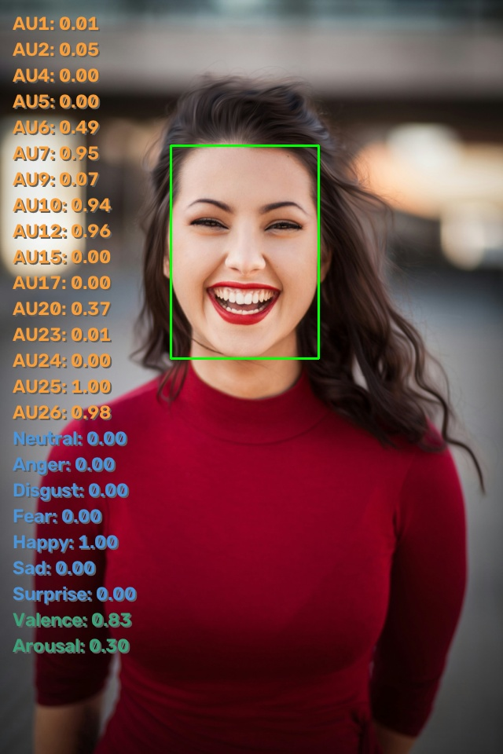

# SeetaPsych Emo

> Facial affect/emotion recognition modules for SeetaPsych

[简体中文](README_CN.md) | English

[](pyproject.toml)
[](LICENSE)

## Usage

This project is already included in the seetapsych-lib default configuration. Download and use it via `seetapsych-manager download`.

For usage, refer to [SeetaPsych](https://github.com/seetapsych/seetapsych-lib).

You can additionally add this algorithm module using the following methods.

### WebUI

Run `seetapsych-webui` with the `--dirs` argument to use it.

```
seetapsych-webui --files seetapsych_emo/modules/emonet.yml
```

### Programmatic Usage

Add the following code in your program to use this algorithm module.

```python
from seetapsych_lib.runtime.factory import Factory
from seetapsych_lib.runtime.pipeline import Pipeline

factory = Factory()
factory.load_file_modules("seetapsych_emo/modules/emonet.yml")

pipeline = Pipeline(factory, ...)

pipeline.add_attributes("face/expression", "face/action_units", "face/dimensional_affect")
```

For complete end-to-end examples with visualization, see:

* [examples/image_emonet.py](examples/image_emonet.py) — static-image emotion, AU, and valence-arousal visualization.
* [examples/camera_emonet.py](examples/camera_emonet.py) — asynchronous live emotion recognition with expression confidence bars and a valence-arousal panel.

Run `python examples/camera_emonet.py` with a webcam connected. The green box identifies the face shown in the dashboard. Press F to toggle fullscreen and Esc, Q, or X to exit. The initial window fits the desktop; resizing and maximizing preserve the camera aspect ratio and redraw the dashboard at the viewport resolution.

The dashboard holds the last completed result while inference runs, replacing it directly when the next result arrives. A no-face result clears the scores; an inference error closes the preview.

The VA panel uses blue-gray-orange for negative-neutral-positive valence and a muted-to-bright purple meter for low-to-high arousal. Plot colors become more vivid toward high arousal. These are visualization conventions, not discrete emotion labels; coordinates and numeric values remain the primary readings.

### Module Catalog

| YAML Path | Packages |
|---|---|
| [emonet.yml](seetapsych_emo/modules/emonet.yml) | Emotions-SeetaEmoNet |

### SeetaEmoNet

Multi-task facial affect estimation: action units, categorical expressions, and continuous valence-arousal dimensions.

<div align="center" id="figure-emonet-result">
  
  <p><em><strong>Figure 1.</strong> SeetaEmoNet output visualization — predicted AUs, expressions, and valence-arousal.</em></p>
</div>

Module config: [emonet.yml](seetapsych_emo/modules/emonet.yml)

| Package Name | Provides Attributes | Requires Attributes |
|---|---|---|
| Emotions-SeetaEmoNet | `face/action_units`, `face/expression`, `face/dimensional_affect` | `face/landmarks` |

**Description**: Unified multi-task MAE-ViT model predicting 16 AUs, 7 expressions, and valence-arousal simultaneously from 5-point aligned face crops.

**Parameters**: *(none)*

**Models**

| Name | Recommended |
|---|---|
| seeta-emo-ufanet-2604.safetensors | ✓ |

**Output Attributes**
- `face/action_units` — [spec](https://github.com/seetapsych/seetapsych-attributes#faceaction_units).
- `face/expression` — [spec](https://github.com/seetapsych/seetapsych-attributes#faceexpression).
- `face/dimensional_affect` — [spec](https://github.com/seetapsych/seetapsych-attributes#facedimensional_affect).

**Output details**:
- `face/expression`: 7 basic expression classes with confidence scores — neutral, anger, disgust, fear, happy, sad, surprise.
- `face/action_units`: 16 Facial Action Units with intensities — AU1, AU2, AU4, AU5, AU6, AU7, AU9, AU10, AU12, AU15, AU17, AU20, AU23, AU24, AU25, AU26.
- `face/dimensional_affect`: Continuous valence and arousal values in a dict `{valence: float, arousal: float}`.
